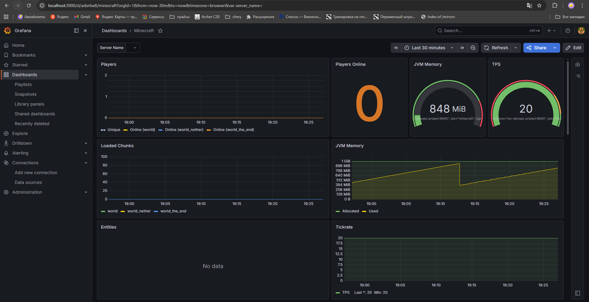
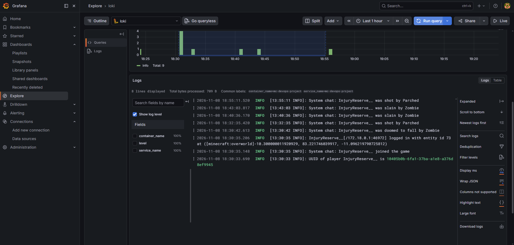

# Minecraft Server Infrastructure with Monitoring & CI/CD

Этот проект представляет собой **полностью автоматизированное production-ready решение** для развертывания игрового сервера Minecraft (Paper) с интегрированной системой резервного копирования и полноценным мониторингом (Prometheus + Grafana).

## 🚀 Архитектурный стек проекта

Инфраструктура построена по методологии **GitOps** и разделена на изолированные уровни ответственности:
* **Уровень ОС и конфигурации (Ansible):** Подготавливает хост-машину, устанавливает Docker, создает структуру директорий и скачивает необходимые плагины.
* **Тестирование конфигурации (Molecule):** Локально валидирует Ansible-роли в изолированных тестовых контейнерах перед деплоем.
* **Уровень оркестрации контейнеров (Terraform):** Декларативно управляет Docker-ресурсами: контейнерами, сетями, томами (Volumes) и конфигурационными файлами.
* **Непрерывная интеграция (GitHub Actions CI/CD):** Автоматически тестирует Ansible-конфигурацию и применяет изменения инфраструктуры через Terraform на self-hosted раннере при каждом пуше в `main`.

---

### grafana дашборд



### loki логи



## 🏗 Структура проекта

```text
minecraft_project/
├── .github/
│   └── workflows/
│       └── deploy.yml          # Пайплайн GitHub Actions (Тесты + Деплой)
├── ansible/
│   ├── roles/
│   │   └── minecraft_server/   # Изолированная роль подготовки сервера
│   │       ├── defaults/       # Переменные (версии плагинов, пути)
│   │       ├── tasks/          # Сценарии установки Docker и плагинов
│   │       └── molecule/       # Сценарии тестирования роли в Docker
│   ├── deploy.yml              # Главный плейбук запуска ролей
│   └── inventory.ini           # Описание целевых хостов (localhost для WSL)
├── terraform/
│   └── main.tf                 # Манифест инфраструктуры Docker
└── .gitignore                  # Глобальный игнор мусора (включая venv и jar)
```

---

## 📊 Схема инфраструктуры Docker

Terraform разворачивает изолированную сеть `minecraft-network`, внутри которой общаются следующие компоненты:

| Контейнер | Назначение | Порт (Host) | Тома (Docker Volumes) |
| :--- | :--- | :--- | :--- |
| **mc-devops-project** | Сервер Minecraft (Paper) + Prometheus Exporter | `25565`, `9940` | `mc_server_data` |
| **mc-backup** | Автоматический бэкап данных сервера каждые 6 часов | — | `mc_server_data` (RO), `mc_server_backups` |
| **prometheus** | Сбор метрик с сервера майна каждые 5 секунд | `9090` | `prometheus_data` |
| **grafana** | Визуализация метрик и дашборды | `3000` | `grafana_data` |

---

## 🛠 Инструкция по локальному запуску

### 1. Подготовка окружения (Ansible)
Для первоначальной подготовки вашей хост-системы (WSL / Ubuntu) выполните плейбук. Он установит Docker и скачает необходимый `.jar`-файл экспортера метрик:

```bash
cd ansible
sudo ansible-playbook -i inventory.ini deploy.yml
```
*Примечание: Плейбук оптимизирован для работы в WSL и запускается локально без SSH.*

### 2. Запуск тестов (Molecule)
Чтобы убедиться, что конфигурационная роль стабильна, запустите Molecule внутри её виртуального окружения:

```bash
cd roles/minecraft_server
source .venv/bin/activate
molecule test
```
*Тесты работают в полностью изолированном offline-режиме, что защищает пайплайн от сетевых сбоев и внешних блокировок.*

### 3. Развертывание инфраструктуры (Terraform)
Если вы хотите применить манифесты Terraform вручную без CI/CD:

```bash
cd ../../../terraform
terraform init
terraform apply -auto-approve
```

---

## 🔄 Описание CI/CD Пайплайна (GitHub Actions)

Автоматизация настроена на базе `self-hosted` раннера и срабатывает при любом событии `push` в ветку `main`. Пайплайн состоит из двух последовательных стадий (Jobs):

1. **Стадия тестирования (`ansible-test`):**
    * Скачивает свежий код из репозитория.
    * Инициализирует окружение и запускает `molecule test`.
    * В случае падения тестов плейбука — деплой полностью блокируется.
2. **Стадия деплоя (`terraform-deploy`):**
    * Запускается только после успешного прохождения тестов Ansible.
    * Переходит в рабочую директорию `working-directory: ./terraform`.
    * Выполняет `terraform init` и безопасно накатывает изменения через `terraform apply -auto-approve`.

---

## 🔐 Безопасность и хранение данных
* Бинарные плагины динамически скачиваются силами Ansible непосредственно в процессе подготовки хоста.
* Контейнер бэкапа имеет права «Только для чтения» (`read_only = true`) на файлы живого сервера Minecraft, что исключает порчу данных при резервном копировании.
